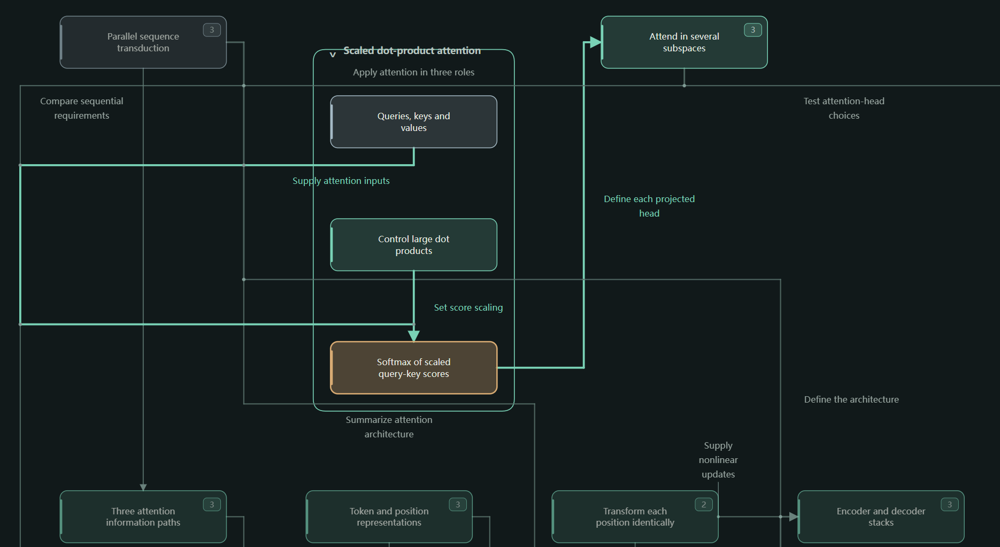

[English](README.md) | [中文](README.zh-CN.md)

# ExtractStructure



## Purpose and main functions

Introduce ExtractStructure article and code analysis, interactive maps, installation and use.

## Scope

For people installing or using this skill; explain inputs, runtime requirements and result delivery.

An Agent Skill that turns documents and code repositories into interactive structure maps.

## What it does

- **Documents:** Analyze Markdown, LaTeX, and PDF files to map key ideas, methods, evidence, and their relationships.
- **Code repositories:** Explain Python project structure, file responsibilities, and how components work together.
- **Interactive viewer:** Explore results by expanding nodes, navigating files, searching, and switching between English and Chinese.

## Examples

- [GPT code structure map](https://atheavenma.github.io/ExtractStructure/examples/gpt-code-structure.html): Explore the structure of GPT model code.
- [Attention Is All You Need paper structure map](https://atheavenma.github.io/ExtractStructure/examples/attention-is-all-you-need-paper-structure.html): Explore the paper's main ideas and their relationships.

Click either link to open the interactive page directly in your browser. Each example is also available as a self-contained HTML file in [`examples/`](examples/) for offline use.

## Install

```bash
npx skills add AtheavenMa/ExtractStructure
```

## Use

Ask your AI agent:

```text
Use extract-structure to visualize this paper: path/to/paper.pdf
Use extract-structure to map this project: path/to/repository/
```

The agent reads the selected material, records source evidence and saves the map. It delivers either an accessible local viewer or an independent HTML page containing the graph data and viewing resources. The host environment supplies file attachments or static hosting when needed.

Hover or focus a node to read its full explanation. Language switching works inside the page and retains the current view. Browser storage is optional; label placement uses background workers when available and page computation otherwise.

## Requirements

Python 3.10+ and a browser. The included graph tools use Python's standard library; PDF reading depends on the host agent's available tools.

## License

Copyright (c) 2026 Haotian Ma.

This project is licensed under the MIT License. See [LICENSE](LICENSE) for details.
