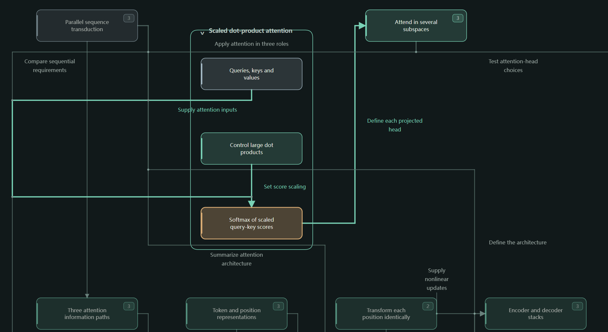

[English](README.md) | [中文](README.zh-CN.md)

# ExtractStructure



一个将文档和代码仓库整理成可交互结构图的智能助手技能。

## 主要功能

- **文档：** 分析 Markdown、LaTeX 和 PDF 文件，呈现主要观点、方法、证据及其关系。
- **代码仓库：** 解释 Python 项目的结构、文件职责，以及各部分如何协作。
- **交互页面：** 通过展开节点、切换文件、搜索和中英文切换来探索结果。

## 示例

- [GPT 代码结构图](https://atheavenma.github.io/ExtractStructure/examples/gpt-code-structure.html)：查看 GPT 模型代码的结构。
- [《Attention Is All You Need》论文结构图](https://atheavenma.github.io/ExtractStructure/examples/attention-is-all-you-need-paper-structure.html)：查看论文的主要内容及其关系。

点击上面的链接即可直接打开交互页面。每个示例的独立 HTML 文件也保存在 [`examples/`](examples/) 中，可下载后离线使用。

## 安装

```bash
npx skills add AtheavenMa/ExtractStructure
```

## 使用

向你的智能助手提出请求：

```text
使用 extract-structure 可视化这篇论文：path/to/paper.pdf
使用 extract-structure 梳理这个项目：path/to/repository/
```

智能助手会阅读你选定的文件，生成可交互的结构图。你可以在本地浏览器中查看，也可以保存为独立 HTML 网页进行分享。

## 运行要求

Python 3.10 及以上版本和浏览器。内置绘图工具使用 Python 标准库；PDF 阅读使用智能助手所在环境提供的工具。

## 许可说明

版权所有 © 2026 Haotian Ma。

本项目采用 MIT 许可证。详情见 [LICENSE](LICENSE)。
